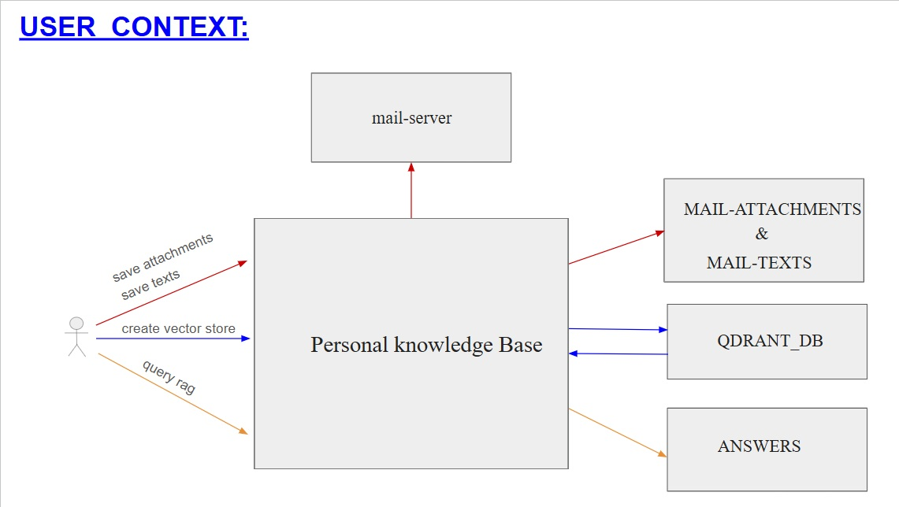
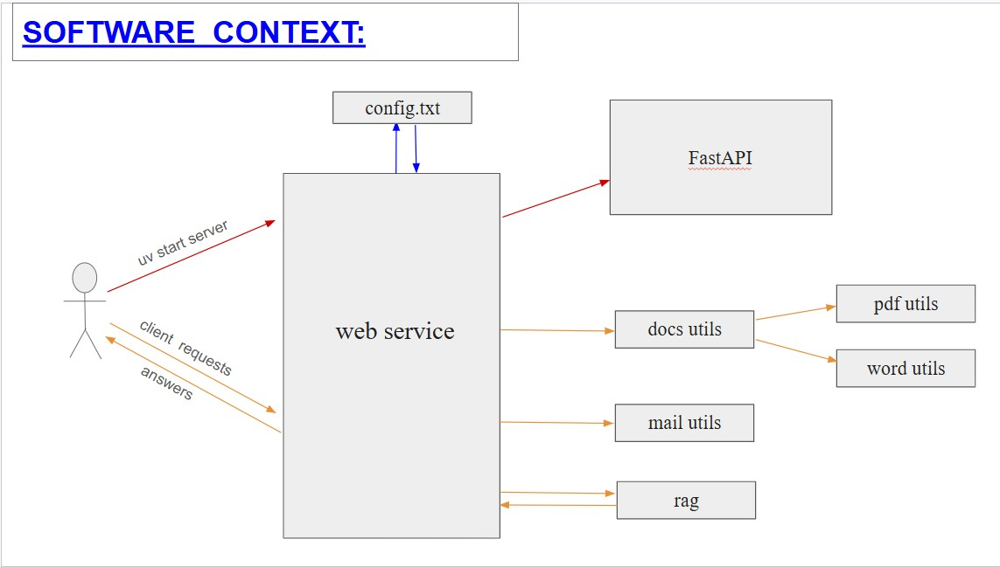

# Personal  Knowledge  Base

This Project lets you extract emails from Folders in your email-account, and from These documents (Texts + attachments) builds a RAG System that can answer Questions regarding the subjects contained in These folders

## Table of Contents

- [Features](#features)
- [Technologies Used](OCR, RAG)
- [Getting Started](#getting-started)
- [Installation](#installation)
- [Usage](#usage)
- [Project Structure](#project-structure)
- [Screenshots](#screenshots)
- [Contributing](#contributing)
- [License](#license)
- [Contact](#contact)


## Features

- extract Texts + attachments of email-Folders in your account
- process the data and build a data-base Ready to be used by a RAG system
- an interface that allows getting answers to queries concerning the subject contained in the emails

## Technologies Used

- Programming language:  Python
- Tools: [ Git, VS Code, uv, FastAPI, imap]


## Getting Started

- create a Password that allows you to contact your email-Account via imap-protocol
-  get an API-KEY for OpenRouter
- choose a Folder where the email-data will reside
- set (or put in a ".env" file) These 2 environment-variable with appropriate.values:
    -  OPENROUTER_API_KEY
    -  MAIL_SERVER_PASSWD
- set values in "config.txt" that are suitable for your system


### Prerequisites

Install:    Git, Python, VS code

## Installation

1. Clone the repository:

   ```bash
   git clone https://github.com/ramimayer/Personal_knowledge_base.git
   ```

2. Open the project directory:

   ```bash
   cd personal_knowledge_base
   ```

3. Install the project's dependencies using the appropriate command.

   For Python projects:

   ```bash
   uv add fastapi
   uv add imap-tools
   uv add pypdf
   uv add pytesseract
   uv add dotenv
   uv add fastembed
   uv add fonttools
   ```

## Usage

1. in the main folder, run the command:   "uv run server"  (starts the server-side)
2. Open a browser, and type "http://localhost:8000/docs" - that will open a UI with the 4 available endpoints are .
3. ALTERNITAVELY - open a web-browser and activate manually one of the 4 endpoints:
                     o   localhost:8000/save_attachments?username=< EMAIL >&email_folder=< EXTRACTED EMAIL FOLDER >_eng&save_folder=< FOLDER TO SAVE DATA >
                     o   localhost:8000/save_texts?username=< EMAIL >&email_folder=< EXTRACTED EMAIL FOLDER >&save_folder=< FOLDER TO SAVE DATA >
                     o   localhost:8000/create_vectorestore/< DOCUMENTS_FOLDER >   
                     o   localhost:8000/query_rag/< QUERY >
4. NOTES:   a) before running "create_vectorestore", do a MANUAL check that < DOCUMENTS_FOLDER > contains valid documents (for now: "pdf" and "txt" files) 
            b) "create_vectorestore" will create a folder named < DOCUMENTS_FOLDER_qdrant_db >
            c) set PKB_QDRANT_DB_PATH (in "config.txt") to the full-path of the qdrant_db created "create_vectorestore" (otherwise - "query_rag" fails)


```bash
# Example
  o   localhost:8000/save_attachments?username=rami.mayer@yahoo.com&email_folder=Simulator_2015_eng&save_folder=att
  o   localhost:8000/save_texts?username=rami.mayer@yahoo.com&email_folder=CodingAcademy&save_folder=msgs"
  o   localhost:8000/localhost:8000/create_vectorestore/my_docs
  o   localhost:8000/query_rag/what is Instrument flying

```

## Project Structure

Example structure (adapt it to your repository):

```text
YOUR_REPOSITORY/
├── personal_knowledge_base/src/             # Source code
├── personal_knowledge_base/tests/           # Test files
├── .gitignore                               # Files ignored by Git
├── README.md                                # Project documentation
├── pyproject.toml                           # Project documentation
└── LICENSE                                  # Project license
```

## Screenshots


```markdown

```




## Contributing

Contributions are welcome!

1. Fork the repository.
2. Create a branch for your change:

   ```bash
   git checkout -b feature/your-feature
   ```

3. Make your changes and test them.
4. Commit your changes:

   ```bash
   git commit -m "Add your feature"
   ```

5. Push your branch:

   ```bash
   git push origin feature/your-feature
   ```

6. Open a Pull Request.

## License

No need for a license

## Contact

Your Name

- GitHub: https://github.com/ramimayer/Personal_knowledge_base.git
- Email: rami.mayer@yahoo.com

## Acknowledgments

- Thanks to Arno Venner  and  Matthias Hölzel   who supported me in this project
